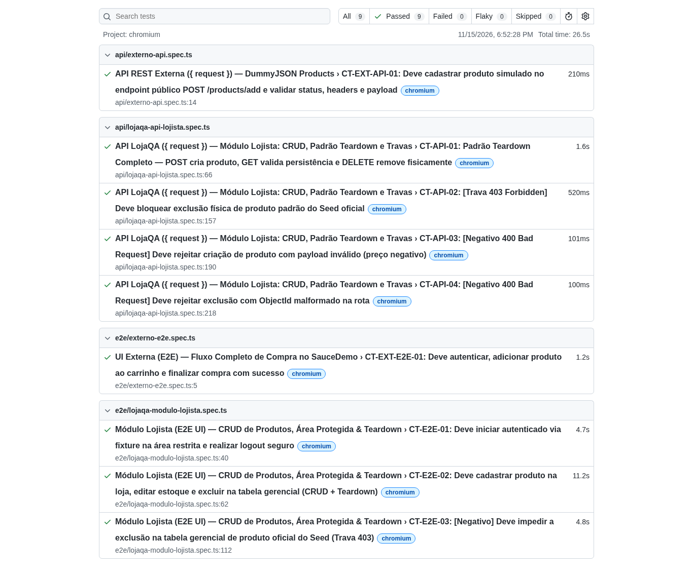
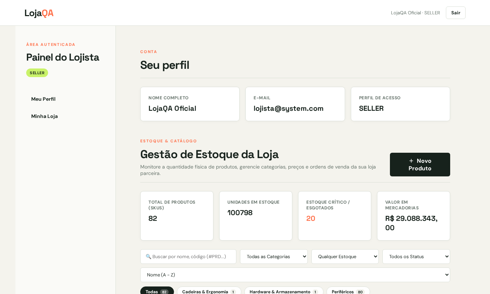
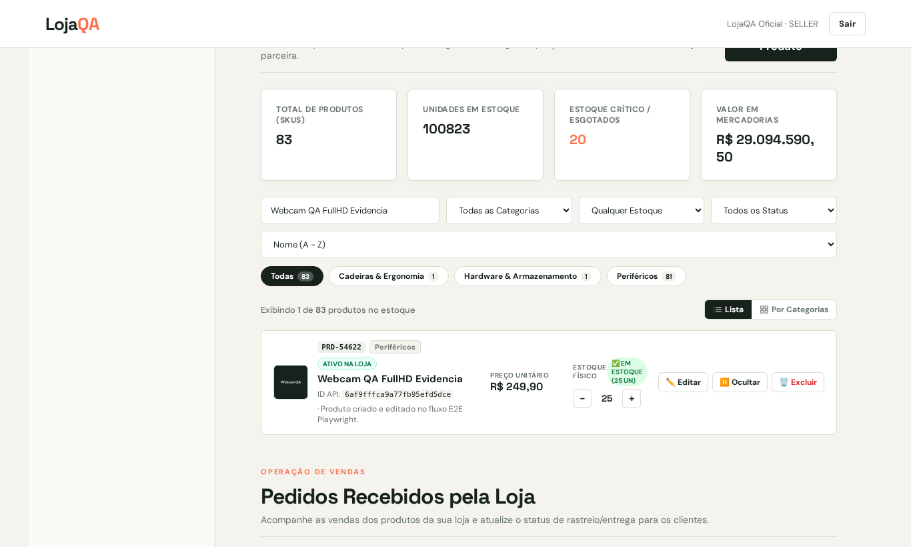
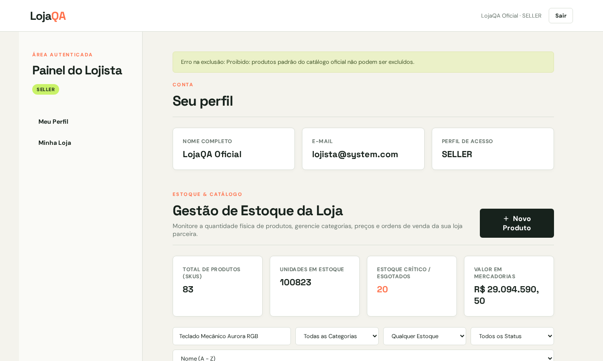
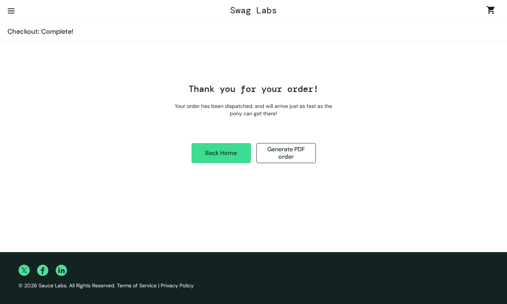

# lojaqa-automacao-# 🛍️ LojaQA — Automação de Testes E2E (UI) e API REST

**Módulo:** Lojista — CRUD de Produtos & Padrão Teardown  
**Stack:** Playwright + TypeScript  
**Programa:** FAP 2026 — Turma 4 | Teste de Software (Orientador: Prof. Alison Melo)

---

## 📌 1. Visão Geral e Contexto de Negócio

Este repositório contém a suíte automatizada de testes **End-to-End (Interface Gráfica)** e **Testes de Contrato/API REST** desenvolvida para o módulo **Painel do Lojista: CRUD de Produtos & Teardown** da plataforma **LojaQA E-commerce Marketplace**, além de cenários complementares em ambientes públicos externos (**SauceDemo** e **DummyJSON**).

### Por que este módulo é crítico para a LojaQA?
1. **Integridade do Catálogo e Faturamento:** Os produtos cadastrados e atualizados pelo lojista abastecem diretamente a vitrine pública e o checkout. Falhas na validação de preço ou estoque geram prejuízo financeiro ou venda sem disponibilidade física.
2. **Segurança e Isolamento Multi-Tenancy (RBAC):** Apenas contas com perfil `seller` (ou `admin`) podem operar sobre `/api/seller/products`, gerenciando exclusivamente os itens da própria loja parceira.
3. **Governança de Dados (Teardown vs. Produção Real) e Travas Anti-Caos:**
   - **No laboratório de QA:** O método `DELETE` físico permite aplicar o padrão **Teardown** (`POST` cria a massa, `GET` valida a persistência e `DELETE` limpa o registro ao final), mantendo os testes independentes e idempotentes sem poluir o banco compartilhado da turma.
   - **Em produção corporativa:** Utiliza-se *Soft Delete* (`active: false`) para preservar a integridade referencial de notas fiscais e pedidos antigos.
   - **Trava Anti-Caos (`403 Forbidden`):** O backend rejeita qualquer tentativa de excluir produtos oficiais do *Seed* da turma (como o *Teclado Mecânico Aurora RGB*), garantindo a estabilidade do ambiente coletivo.

---

## 🌐 2. Ambientes Utilizados

| Camada / Serviço | URL Oficial | Finalidade na Suíte |
|---|---|---|
| **LojaQA — UI (Frontend)** | `https://alisonmelo.github.io/tioalison-pe-t4-fap26/projetos-base/01-sistema-login/loja.html` | Testes E2E do Painel do Lojista, Área Protegida e Logout |
| **LojaQA — API (Backend)** | `https://api-qa-fap2026.onrender.com/api` | Testes de API REST (`{ request }`), CRUD, Teardown e Travas `403`/`400` |
| **SauceDemo (UI Externa)** | `https://www.saucedemo.com/` | 1 Caso de Teste E2E completo de compra em site público externo |
| **DummyJSON (API Externa)** | `https://dummyjson.com` | 1 Caso de Teste de API REST pública com validação de status e payload |

---

## 🗂️ 3. Estrutura do Repositório e Arquitetura

```text
lojaqa-automacao-banca/
├── pages/
│   ├── LojistaPage.ts                  # Page Object do módulo Lojista (SEM asserções internas)
│   └── SauceDemoPage.ts                # Page Object do site externo SauceDemo (SEM asserções internas)
├── fixtures/
│   └── auth.fixture.ts                 # Fixture autenticada (test.extend<{ lojistaPage: LojistaPage }>)
├── tests/
│   ├── e2e/
│   │   ├── lojaQA-mlojista.spec.ts  # 3 CTs E2E do módulo Lojista na LojaQA
│   │   └── saucedemo.spec.ts            # 1 CT E2E completo no SauceDemo
│   └── api/
│       ├── lojaQA-apilojista.spec.ts     # 4 CTs de API da LojaQA ({ request })
│       └── dummyjson.spec.ts            # 1 CT de API na DummyJSON ({ request })
├── docs/
│   └── evidencias/                     # Capturas de tela reais da execução dos testes
│   └── presentation/                   
│      └── apresentacao-slides.pdf      # Slides da apresentação para a banca (.pdf)
├── playwright.config.ts                # Configuração global do Playwright
├── tsconfig.json                       # Tipagem estrita do TypeScript
├── package.json                        # Scripts e dependências do projeto
└── README.md                           # Documentação completa de uso e evidências
```

### Pilares Arquiteturais Aplicados
- **Page Object Model (POM) Puro:**
  - Injeção de dependência estrita no construtor: `constructor(private page: Page)`.
  - Mapeamento semântico da área protegida: identificador do usuário autenticado no cabeçalho, título da página (`Painel do Lojista`), badge de perfil (`SELLER`) e botão `Sair` com método de ação `logout()`.
  - **Regra inegociável respeitada:** Nenhuma chamada de asserção reside dentro da pasta `pages/` — todas as validações ficam exclusivamente nos arquivos `.spec.ts`.
- **Fixture Autenticada (`fixtures/auth.fixture.ts`):**
  - Estende o runner base com `test.extend<{ lojistaPage: LojistaPage }>`.
  - Encapsula navegação para `login.html`, preenchimento de credenciais válidas (`lojista@system.com`), submissão, espera ativa pela URL restrita (`painel.html`) e carregamento do estoque antes de entregar a página pronta com `await use(lojistaPage)`.
- **Sincronização Limpa e Semântica:**
  - Seletores semânticos (`getByRole`, `getByLabel`, `getByText`, `getByTestId`) e sincronização determinística por estado/rede (`waitForURL`, `waitForResponse`), sem pausas arbitrárias.

---

## 🚀 4. Como Instalar e Executar

### Pré-requisitos
- **Node.js** 18+ instalado (`node -v`)
- **npm** instalado (`npm -v`)

### Passo 1 — Instalar dependências e navegador do Playwright
Dentro da pasta `lojaqa-automacao-banca/`:

```bash
npm install
npx playwright install chromium
```

### Passo 2 — Comandos de Execução

```bash
# Executar TODA a suíte com navegador visível (--headed) — Ideal para apresentação à banca
npm run test:headed

# Executar apenas os testes E2E (UI) com navegador visível (--headed)
npm run test:e2e

# Executar apenas os testes de API REST ({ request }) exibindo logs detalhados no console
npm run test:api

# Executar apenas os testes da LojaQA (E2E + API) com navegador visível
npm run test:lojaqa

# Executar apenas os testes externos (SauceDemo E2E + DummyJSON API) com navegador visível
npm run test:externos

# Executar em modo headless padrão (CI / validação rápida)
npm test

# Validar tipagem estática do TypeScript
npm run typecheck

# Abrir o relatório visual HTML gerado pelo Playwright
npm run report
```

---

## 🧪 5. Matriz de Testes (9 Cenários Automatizados)

| ID | Arquivo Spec | Cenário | Tipo | Resultado Esperado |
|---|---|---|---|---|
| **CT-E2E-01** | `lojaqa-modulo-lojista.spec.ts` | Iniciar autenticado via `auth.fixture` na área restrita e realizar `logout()` seguro | E2E (UI) | Inicia em `painel.html` sem digitar credenciais no teste; valida título, badge `SELLER` e usuário; após `logout()`, retorna a `loja.html` sem token no `localStorage`. |
| **CT-E2E-02** | `lojaqa-modulo-lojista.spec.ts` | Cadastrar produto na loja, editar estoque (10 → 25 un) e excluir na tabela gerencial | E2E (UI) | Produto é criado, exibe estoque atualizado (`25 un`) na tabela gerencial e é excluído fisicamente após confirmação no diálogo nativo (HTTP `200`). |
| **CT-E2E-03** | `lojaqa-modulo-lojista.spec.ts` | **[Negativo]** Tentar excluir produto oficial do *Seed* na tabela gerencial | E2E (UI) | API responde `403 Forbidden`, painel exibe mensagem de bloqueio anti-caos e o item *Teclado Mecânico Aurora RGB* permanece visível. |
| **CT-API-01** | `lojaqa-api-lojista.spec.ts` | Padrão Teardown completo: `POST` cria, `GET` valida persistência e `DELETE` remove | API REST | `201 Created` na criação, `200 OK` na listagem confirmando o `_id` criado e `200 OK` na exclusão física garantida em bloco `finally`. |
| **CT-API-02** | `lojaqa-api-lojista.spec.ts` | **[Trava 403]** Tentar deletar produto oficial do *Seed* via `DELETE /seller/products/:id` | API REST | Retorna `403 Forbidden`, header `application/json` e erro `"Proibido: produtos padrão do catálogo oficial não podem ser excluídos."`. |
| **CT-API-03** | `lojaqa-api-lojista.spec.ts` | **[Negativo 400]** Cadastrar produto com payload inválido (preço negativo `-10`) | API REST | Retorna `400 Bad Request` e mensagem `"Nome, categoria, preço e estoque válidos são obrigatórios."`. |
| **CT-API-04** | `lojaqa-api-lojista.spec.ts` | **[Negativo 400]** Deletar produto informando ObjectId malformado (`id_invalido_123`) | API REST | Retorna `400 Bad Request` e mensagem `"ID de produto inválido."`. |
| **CT-EXT-E2E-01** | `externo-e2e.spec.ts` | Autenticar, adicionar item ao carrinho e finalizar checkout no **SauceDemo** | E2E Externo | Conclui jornada de compra em `checkout-complete.html` exibindo `"Thank you for your order!"`. |
| **CT-EXT-API-01** | `externo-api.spec.ts` | Cadastrar produto simulado em `POST /products/add` na **DummyJSON** | API Externa | Retorna `201 Created`, header `application/json` e payload contendo `id` numérico e dados enviados. |

---

## 📸 6. Evidências Reais de Execução (Prints & Console)

### 6.1 Relatório HTML Oficial do Playwright (`9 passed`)


### 6.2 Área Protegida do Lojista Autenticada via Fixture (`CT-E2E-01`)


### 6.3 Produto Criado e Estoque Editado para 25 Unidades na Tabela Gerencial (`CT-E2E-02`)


### 6.4 Trava Anti-Caos 403 Bloqueando Exclusão de Produto do Seed (`CT-E2E-03`)


### 6.5 Caso de Teste E2E Externo — Checkout Completo no SauceDemo (`CT-EXT-E2E-01`)


### 6.6 Saída no Console dos Testes de API (`Status Code`, `Headers` e `Response JSON`)
```text
[SETUP AUTH] Login via POST /api/login concluído com sucesso:
  • Status Code : 200 (OK)
  • Header      : content-type = application/json; charset=utf-8
  • Perfil JWT  : lojista@system.com (role: seller)

[CT-API-01 | ETAPA 1 - POST /seller/products]
  • Status Code : 201 (Esperado: 201 Created)
  • Header      : content-type = application/json; charset=utf-8
  • Response    : {"message":"Produto criado com sucesso.","_id":"6af9ff6ea9a77fb95efd569f","name":"Headset Studio QA API 1794768750248","stock":15}
[CT-API-01 | ETAPA 2 - GET /seller/products]
  • Status Code : 200 (Esperado: 200 OK)
  • Header      : content-type = application/json; charset=utf-8
  • Encontrado  : true (ID 6af9ff6ea9a77fb95efd569f, estoque: 15)
[CT-API-01 | ETAPA 3 - DELETE /seller/products/:id (TEARDOWN)]
  • Status Code : 200 (Esperado: 200 OK)
  • Header      : content-type = application/json; charset=utf-8
  • Response    : {"message":"Produto excluído com sucesso.","id":"6af9ff6ea9a77fb95efd569f"}

[CT-API-02 | TRAVA ANTI-CAOS 403 - DELETE /seller/products/:seedId]
  • Produto Alvo: Teclado Mecânico Aurora RGB (6aec92bc2fca730ea168656d)
  • Status Code : 403 (Esperado: 403 Forbidden)
  • Header      : content-type = application/json; charset=utf-8
  • Response    : {"error":"Proibido: produtos padrão do catálogo oficial não podem ser excluídos."}

[CT-API-03 | CENÁRIO NEGATIVO 400 - POST /seller/products com preço -10]
  • Status Code : 400 (Esperado: 400 Bad Request)
  • Header      : content-type = application/json; charset=utf-8
  • Response    : {"error":"Nome, categoria, preço e estoque válidos são obrigatórios."}

[CT-API-04 | CENÁRIO NEGATIVO 400 - DELETE /seller/products/id_invalido_123]
  • Status Code : 400 (Esperado: 400 Bad Request)
  • Header      : content-type = application/json; charset=utf-8
  • Response    : {"error":"ID de produto inválido."}

[CT-EXT-API-01 | API EXTERNA DUMMYJSON - POST /products/add]
  • Status Code : 201 (Esperado: 201 Created)
  • Header      : content-type = application/json; charset=utf-8
  • Response    : {"id":195,"title":"Teclado Mecânico Compacto QA","price":299.9,"stock":20,"category":"laptops"}
```

---

## 📊 7. Apresentação de Slides

Os slides preparados para apresentação à banca encontram-se em:
- [`presentation/apresentacao-slides.pdf`](docs/presentation/apresentacao-slides.pdf)
