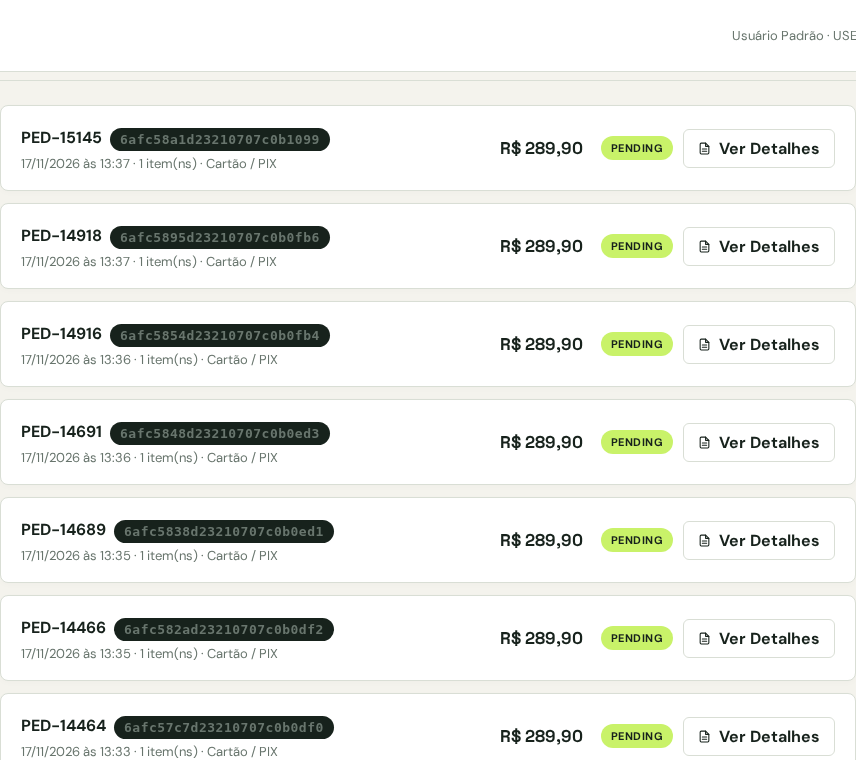
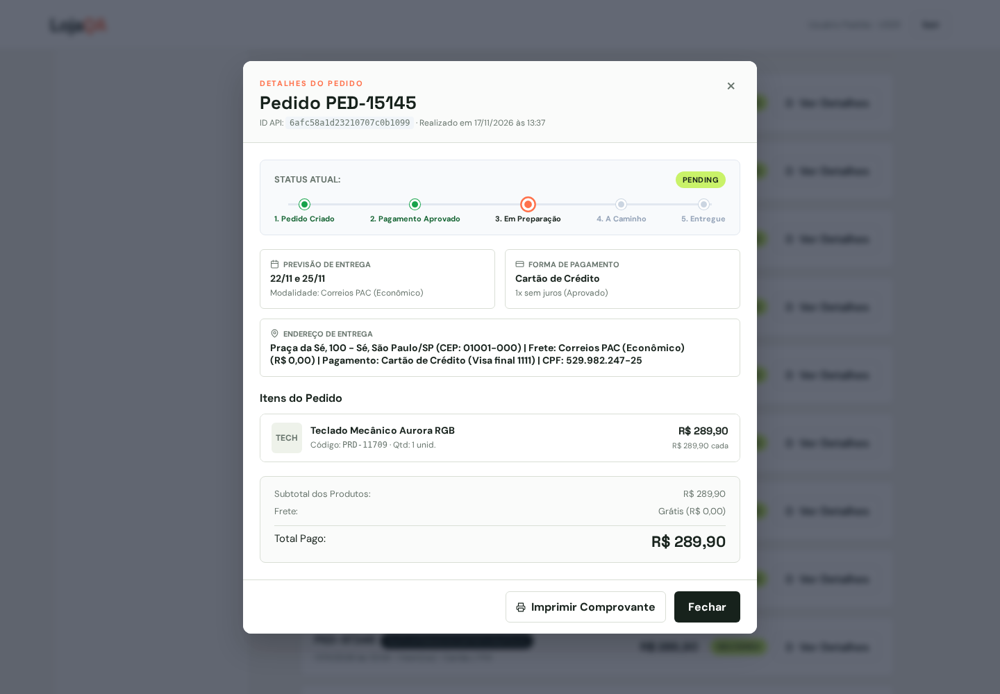
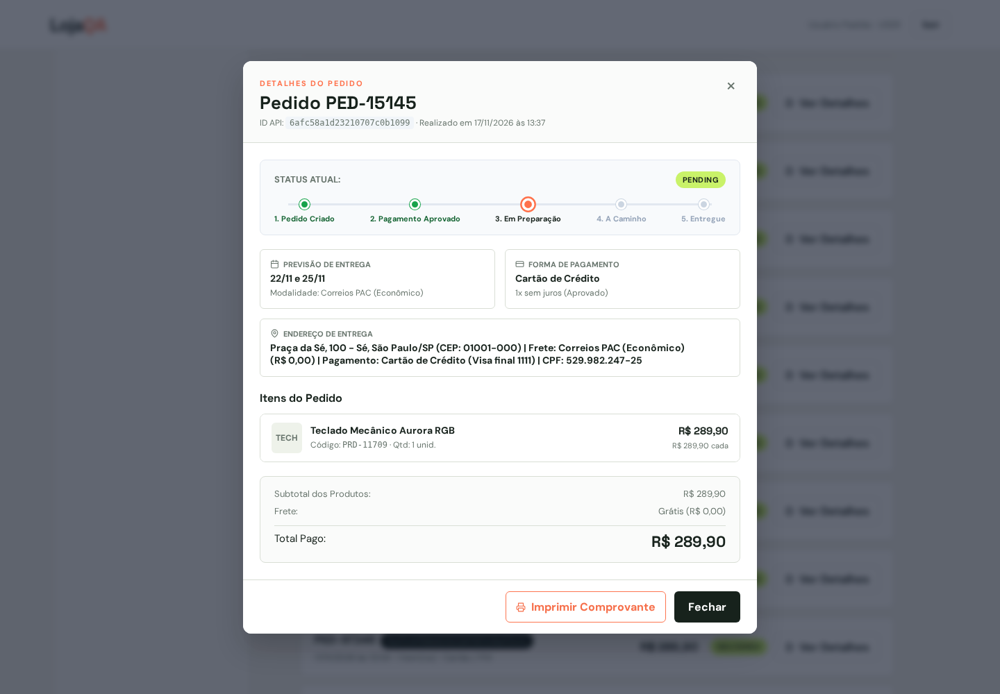
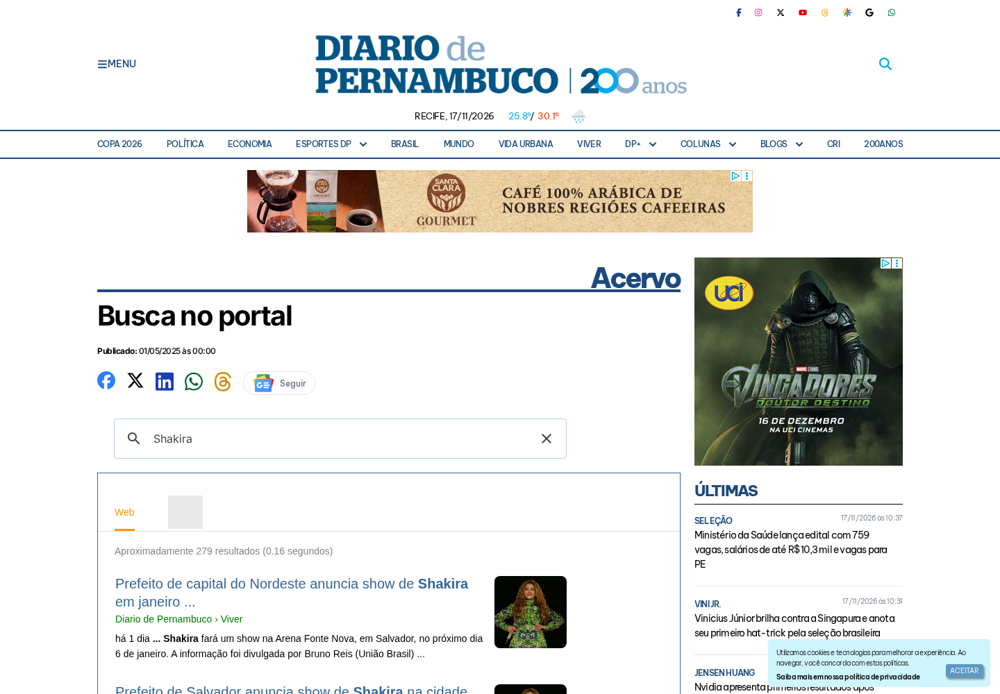

# LojaQA — Automação de Testes E2E (UI) e API REST

**Módulo:** Painel do Cliente — Pedidos & Rastreio
**Stack:** Playwright + TypeScript
**Programa:** FAP 2026 — Turma 4 | Teste de Software (Orientador: Prof. Alison Melo)

---

## 1. Visão Geral e Contexto de Negócio

Este repositório contém a suíte automatizada de testes **End-to-End (Interface Gráfica)** e de **Contrato/API REST** do módulo **Painel do Cliente: Pedidos & Rastreio** da plataforma **LojaQA E-commerce Marketplace**, além de cenários complementares em ambientes públicos externos (**Diario de Pernambuco** e **DummyJSON**).

### Por que este módulo é crítico para a LojaQA?

1. **Confiança pós-compra (Pós-venda):** após concluir o checkout, o cliente só tem certeza de que a compra existe por meio do histórico de pedidos. Se a listagem não carregar, exibir valor errado ou omitir um pedido, o cliente abre reclamação, cancela no cartão e a plataforma perde receita e reputação.
2. **Comprovação documental (Impressão):** o comprovante impresso é usado pelo cliente em garantia, reembolso e disputa com o cartão. O documento precisa refletir **exatamente** o pedido selecionado (ID, itens, endereço e total pago).
3. **Segurança e Isolamento Multi-Tenancy (RBAC):** `GET /api/orders/me` só pode devolver os pedidos do próprio titular do token. Um vazamento de histórico entre clientes é incidente de privacidade (LGPD) e a rota também precisa rejeitar requisições anônimas com **`403 Forbidden`** (*fail closed*).

### Estratégia de massa de dados: testes READ-ONLY e idempotentes

Diferente do padrão *Teardown* (`POST` cria → `GET` valida → `DELETE` limpa) usado no módulo de catálogo, o domínio de **pedidos** é **imutável e auditável** por natureza:

- `POST /api/orders` **decrementa estoque real** dos produtos da turma;
- a API **não expõe** rota de exclusão de pedidos (`DELETE /api/orders/:id` → `404`, conforme verificado — em produção corporativa isso é proposital, para preservar integridade referencial e notas fiscais).

Criar massa de pedido em cada execução, portanto, **poluiria o banco compartilhado** e alteraria o estoque dos colegas. A suíte resolve isso sendo **read-only**:

1. o fixture `pedidosDoCliente` lê o histórico real via `GET /orders/me` (fonte da verdade);
2. o teste compara o que a **UI** exibe com o que a **API** devolve — nada é criado, alterado ou excluído;
3. execuções repetidas produzem o mesmo resultado (idempotência) sem qualquer resíduo.

---

## 2. Ambientes Utilizados

| Camada / Serviço | URL Oficial | Finalidade na Suíte |
|---|---|---|
| **LojaQA — UI (Frontend)** | `https://alisonmelo.github.io/tioalison-pe-t4-fap26/projetos-base/01-sistema-login/` | Login do cliente, `painel.html`, listagem de pedidos, modal de rastreio e impressão de comprovante |
| **LojaQA — API (Backend)** | `https://api-qa-fap2026.onrender.com/api` | Testes de contrato de `POST /login` e `GET /orders/me` (Bearer Token e `403` sem token) |
| **Diario de Pernambuco (UI Externa)** | `https://www.diariodepernambuco.com.br/` | 1 Caso de Teste E2E de busca de conteúdo, com validação da data de publicação e da autoria da matéria |
| **DummyJSON (API Externa)** | `https://dummyjson.com` | 1 Caso de Teste de API REST pública com validação de status e payload |

**Massa de dados oficial do cliente** (divulgada na própria tela de login):

| Perfil | E-mail | Senha |
|---|---|---|
| Cliente (`user`) | `user@system.com` | `UserPassword123` |

> As credenciais podem ser sobrescritas sem alterar código: `LOJAQA_CLIENTE_EMAIL`, `LOJAQA_CLIENTE_PASSWORD` e `LOJAQA_API_URL`.

---

## 3. Estrutura do Repositório e Arquitetura

```text
lojaqa-automacao-banca/
├── docs/
│   ├── evidencias/                      # Capturas reais da execução
│   └── presentation/                    # Slides da banca (10 slides) em .pptx
├── fixtures/
├── pages/
│   ├── ClientePage.ts                   # Page Object (SEM Asserts)
│   └── DiarioPage.ts                    # Page Object (SEM Asserts)
├── tests/
│   ├── e2e/
│   │   ├── lojaQA-mcliente.spec.ts      # 4 CTs E2E do Painel do Cliente
│   │   └── diariodepernambuco.spec.ts   # 1 CT E2E no Diario de Pernambuco
│   └── api/
│       ├── lojaQA-apicliente.spec.ts    # 2 CTs de API de GET /orders/me
│       └── dummyjson.spec.ts            # 1 CT de API na DummyJSON
├── .gitignore                           # Arquivos e pastas ignorados pelo Git
├── README.md                            # Documentação completa e evidências
├── package-lock.json                    # Versões exatas das dependências
├── package.json                         # Scripts e dependências do projeto
├── playwright.config.ts                 # Configuração global do Playwright
└── tsconfig.json                        # Tipagem estrita do TypeScript
```

### Pilares Arquiteturais Aplicados

- **Page Object Model (POM) Puro**
  - Injeção de dependência estrita no construtor: `constructor(private page: Page)`.
  - **Regra inegociável respeitada:** nenhuma asserção vive na pasta `pages/` — todas as validações ficam exclusivamente nos arquivos `.spec.ts`. O Page Object expõe *locators* e *ações*; quem julga é o teste.
  - Ações com sincronização embutida: `autenticarComoCliente()` só devolve o controle depois da resposta de `GET /orders/me` **e** da renderização da listagem; `abrirDetalhesDoPedido()` espera a timeline ficar visível.

- **Seletores semânticos primeiro (com fallback documentado)**
  - Preferência absoluta por `getByRole`, `getByLabel` e `getByText`: título `Minha Conta`, badge `USER`, `Meus Pedidos`, `Ver Detalhes`, `Imprimir Comprovante`, `Fechar`.
  - Onde a aplicação **não expõe papel ARIA** (o modal de detalhes não é `role="dialog"`, os passos do stepper e os valores monetários do comprovante são `div/span` sem nome acessível), o fallback é explícito e comentado no código: `#ordersSection`, `#orderDetailModal` (ancorado pelo título `Pedido PED-00000`), `#modalOrderTotal`, `.step.is-done/is-active`. Todos foram validados contra o DOM real.

- **Fixtures Autenticadas (`fixtures/auth.fixture.ts`)**
  - `clientePage`: navega para `login.html`, preenche as credenciais do cliente, submete, espera a URL restrita (`painel.html`), a resposta de `GET /orders/me` e a primeira linha renderizada; entrega a página pronta via `await use(clientePage)`.
  - `tokenCliente`: autentica via `POST /api/login` com o fixture `request` e entrega o Bearer Token.
  - `pedidosDoCliente`: consulta `GET /api/orders/me` com o token e entrega a massa tipada (`PedidoApi[]`), usada como fonte da verdade nos testes E2E. O setup **falha rápido** (`throw`) com mensagem clara se o ambiente não responder, em vez de gerar falhas confusas no meio do cenário.

- **Sincronização limpa e semântica**
  - `waitForURL`, `waitForResponse`, `expect.poll` e auto-waiting do Playwright — **nenhum `sleep`/`waitForTimeout`** em todo o repositório.

- **Tipagem estrita ponta a ponta**
  - Interfaces `PedidoApi`, `ItemPedidoApi` e `RespostaLoginApi` espelham o schema `Order` do contrato **`APILOJAQA.YAML`**; `tsc --noEmit` (`npm run typecheck`) roda limpo.

---

## 4. Como Instalar e Executar

### Pré-requisitos

- **Node.js** 20 ou superior — confira com `node -v`
- **npm** 10 ou superior — confira com `npm -v`

### Passo 1 — Instalar dependências e navegador do Playwright

Dentro da pasta `lojaqa-automacao-banca/`:

```bash
npm install
npx playwright install --with-deps chromium
```

### Passo 2 — Comandos de execução

```bash
# Executar TODA a suíte (headless)
npm test

# Executar TODA a suíte com navegador visível (--headed) — ideal para a banca
npm run test:headed

# Executar apenas os testes E2E (UI) com navegador visível
npm run test:e2e

# E2E do Painel do Cliente em CÂMERA LENTA (automação visível a olho nu)
npm run test:lento

# Toda a suíte em câmera lenta
npm run test:lento:tudo

# Executar apenas os testes de API REST ({ request }) com logs detalhados no console
npm run test:api

# Executar apenas os cenários LojaQA do módulo (E2E + API)
npm run test:lojaqa

# Executar apenas os E2E do Painel do Cliente (listagem, rastreio, impressão)
npm run test:pedidos

# Executar apenas os testes de contrato da API (GET /orders/me)
npm run test:contrato

# Executar apenas os cenários externos (Diario de Pernambuco + DummyJSON)
npm run test:externos

# Executar apenas o cenário E2E do portal Diario de Pernambuco
npm run test:diario

# Executar um único teste filtrando pelo ID da matriz
npx playwright test -g "CT-E2E-CL-02" --headed

# Executar um único teste filtrando por um trecho do título
npx playwright test -g "comprovante" --headed

# Validar tipagem estática do TypeScript
npm run typecheck

# Abrir o relatório visual HTML gerado pelo Playwright
npm run report
```

### Câmera lenta: ver a automação acontecendo

O Playwright executa ações em velocidade de máquina — em `--headed` o navegador abre e fecha
rápido demais para acompanhar a olho nu. Para a apresentação, a suíte aceita a variável
**`SLOW_MO`** (milissegundos de pausa **entre cada ação**: cliques, digitação, navegação).

```bash
# Padrão didático: 1s por ação, só nos E2E do Painel do Cliente
npm run test:lento

# Escolher a velocidade (0 = velocidade normal; valores altos = mais lento)
SLOW_MO=1500 npx playwright test tests/e2e/lojaQA-mcliente.spec.ts --headed
SLOW_MO=600  npm test

# Um único cenário, bem devagar
SLOW_MO=2000 npx playwright test -g "CT-E2E-CL-02" --headed
```

| `SLOW_MO` | Suíte E2E do Painel do Cliente (`lojaQA-mcliente.spec.ts`) |
|---|---|
| `0` (padrão) | ~19s — velocidade normal, usada em CI |
| `800` | ~31s |
| `1000` (`npm run test:lento`) | ~35s |
| `1500` | ~42s |

Os testes de API (`tests/api/`) não abrem navegador, então `SLOW_MO` não os afeta — o atraso é
aplicado às ações do Chromium.

Pontos importantes:

- **Nenhum teste depende do `SLOW_MO`**: o atraso é só de exibição (`launchOptions.slowMo`).
  A lógica, os seletores e as asserções continuam iguais — o que muda é apenas quanto tempo
  cada ação leva na tela.
- **Timeouts acompanham o atraso**: com `SLOW_MO` ativo o `playwright.config.ts` eleva o
  timeout de teste para 240s e o de asserção para 30s, evitando falso negativo por lentidão.
- **Windows (PowerShell)**: a sintaxe `SLOW_MO=1000 npm test` é de shell POSIX. No PowerShell use
  `$env:SLOW_MO=1000; npm test` e depois `Remove-Item Env:SLOW_MO`.
- **Sem tela (servidor/CI)**: `--headed` precisa de display; use
  `xvfb-run -a npx playwright test tests/e2e/lojaQA-mcliente.spec.ts --headed`.

---

## 5. Matriz de Testes (8 cenários automatizados)

> **Legenda:** ✅ automatizado e verde · 🐞 defeito conhecido documentado (`test.fixme`, não quebra o pipeline)

| ID | Arquivo Spec | Cenário | Tipo | Resultado Esperado | Status |
|---|---|---|---|---|---|
| **CT-E2E-CL-01** | `lojaQA-mcliente.spec.ts` | **Listagem de pedidos**: cliente autenticado via fixture acessa "Meus Pedidos" e confere o histórico | E2E (UI) | Inicia em `painel.html` sem digitar credenciais no spec; título `Minha Conta`, badge `USER`; cada pedido exibe ID visual (`PED-00000`), ObjectId cru, status e total idênticos ao retorno de `GET /orders/me`; o pedido mais recente aparece na primeira posição | ✅ |
| **CT-E2E-CL-02** | `lojaQA-mcliente.spec.ts` | **Timeline de rastreio (stepper visual)** para pedido em andamento | E2E (UI) | Modal abre pelo botão `Ver Detalhes`; 5 passos com os rótulos oficiais na ordem correta; marcadores visíveis; passos 1–2 `is-done`, passo 3 `is-active` (`Em Preparação`), 4–5 pendentes; **exatamente uma** etapa ativa; itens, endereço e total conferem com a API; modal fecha sem resíduo | ✅ |
| **CT-E2E-CL-03** | `lojaQA-mcliente.spec.ts` | **Timeline de rastreio para pedido `delivered`** | E2E (UI) | Pedido entregue deveria exibir passos 1–5 concluídos e etapa 5 (`Entregue`) ativa — **defeito conhecido BUG-01**, registrado com `test.fixme` | 🐞 |
| **CT-E2E-CL-04** | `lojaQA-mcliente.spec.ts` | **Impressão de comprovante** | E2E (UI) | `Imprimir Comprovante` dispara `window.print()` **uma única vez** (stub instrumentado, sem abrir diálogo nativo); comprovante contém ID do pedido, data, status, itens, endereço e total pago; modal permanece aberto e íntegro também em `emulateMedia({ media: 'print' })` | ✅ |
| **CT-API-CL-01** | `lojaQA-apicliente.spec.ts` | **`GET /orders/me` com Bearer Token** válido | API REST | `200 OK`, `content-type: application/json`, lista não vazia; cada `Order` valida `_id` (ObjectId), `status` no enum do contrato, `items` (`quantity`/`unitPrice`), `total` = soma dos itens, datas ISO; **isolamento multi-tenancy**: todos os `customerId` iguais ao claim `id` do JWT; sem duplicidade; ordenado do mais recente ao mais antigo | ✅ |
| **CT-API-CL-02** | `lojaQA-apicliente.spec.ts` | **`GET /orders/me` sem token** *(negativo)* | API REST | `403 Forbidden`, `content-type: application/json`, erro `"Token não fornecido."` e **nenhum dado** de pedido/cliente vazado no corpo | ✅ |
| **CT-EXT-E2E-02** | `diariodepernambuco.spec.ts` | **Busca no Diario de Pernambuco**: localizar uma matéria específica pela pesquisa do portal | E2E Externo | Busca pelo termo `Shakira` na home abre `/capa_busca.html?q=Shakira` com `h1` "Busca no portal" e resultados renderizados; o resultado da matéria `11729214` aparece com a manchete esperada e, ao ser aberto em nova aba (`target="_blank"`), a página exibe exatamente `Publicado: 16/11/2026 às 06:29` (confirmado pela meta `article:published_time`) e a assinatura `Estadão Conteúdo` (confirmada por `meta[name=author]`) | ✅ |
| **CT-EXT-API-01** | `dummyjson.spec.ts` | Cadastrar produto simulado em `POST /products/add` na **DummyJSON** | API Externa | `201 Created`, header `application/json` e payload contendo `id` numérico e dados enviados | ✅ |

**Resultado da execução completa:** `7 passed, 1 skipped (fixme)` em ~35s.

---

## 6. Evidências Reais de Execução (Prints & Console)

Todas as imagens abaixo foram capturadas da aplicação real em produção durante a execução da suíte.

### 6.1 Listagem de pedidos do cliente autenticado (`CT-E2E-CL-01`)


### 6.2 Timeline de rastreio — stepper visual (`CT-E2E-CL-02`)


### 6.3 Impressão do comprovante em mídia de impressão (`CT-E2E-CL-04`)


### 6.4 Comprovante renderizado para impressão (PDF)
[`docs/evidencias/04-comprovante-pedido.pdf`](docs/evidencias/04-comprovante-pedido.pdf)

### 6.5 Resultados da busca pelo termo "Shakira" (`CT-EXT-E2E-02`)


### 6.6 Matéria localizada pela busca: `Publicado: 16/11/2026 às 06:29` e autoria `Estadão Conteúdo` (`CT-EXT-E2E-02`)


### 6.7 Saída no console dos testes de API (`Status Code`, `Headers` e `Response JSON`)

```text
[SETUP AUTH] Login de cliente via POST /api/login concluído com sucesso:
  • Status Code : 200 (OK)
  • Header      : content-type = application/json; charset=utf-8
  • Perfil JWT  : user@system.com (role: user)
  • customerId  : 6abe519f384f04df16c614fa (claim "id" do token)

[CT-API-CL-01 | GET /orders/me com Bearer Token]
  • Status Code : 200 (Esperado: 200 OK)
  • Header      : content-type = application/json; charset=utf-8
  • Pedidos     : 203
  • Amostra     : {"_id":"6afac268c26b225ee582fe71","customerId":"6abe519f384f04df16c614fa","total":169.9,"status":"pending"}

[CT-API-CL-02 | CENÁRIO NEGATIVO 403 - GET /orders/me SEM TOKEN]
  • Status Code : 403 (Esperado: 403 Forbidden)
  • Header      : content-type = application/json; charset=utf-8
  • Response    : {"error":"Token não fornecido."}

[CT-EXT-API-01 | API EXTERNA DUMMYJSON - POST /products/add]
  • Status Code : 201 (Esperado: 201 Created)
  • Header      : content-type = application/json; charset=utf-8
  • Response    : {"id":195,"title":"Teclado Mecânico Compacto QA","price":299.9,"stock":20,"category":"laptops"}
```

### 6.8 Saída no console dos testes E2E do módulo

```text
[CT-E2E-CL-01 | LISTAGEM DE PEDIDOS]
  • Cliente autenticado : user@system.com (role: USER)
  • Pedidos na API      : 203
  • Pedidos na UI       : 203
  • 6afac268c26b225ee582fe71 → status PENDING · total R$ 169,90 · 1 item(ns)
  • 6afac1e8c26b225ee582fe6f → status PENDING · total R$ 899,90 · 1 item(ns)
  • 6afaae80a12183da997d9711 → status PENDING · total R$ 899,90 · 1 item(ns)

[CT-E2E-CL-02 | TIMELINE DE RASTREIO] Pedido 6afac268c26b225ee582fe71
  • Status API/UI       : PENDING
  • Etapa ativa         : 3. Em Preparação
  • Timeline            : 1. Pedido Criado [concluído] → 2. Pagamento Aprovado [concluído] → 3. Em Preparação [pendente/ativo] → 4. A Caminho [pendente] → 5. Entregue [pendente]

[CT-E2E-CL-04 | IMPRESSÃO DE COMPROVANTE]
  • Pedido impresso     : 6afac268c26b225ee582fe71
  • Total no comprovante: R$ 169,90
  • window.print()      : 1 disparo capturado (stub instrumentado)
  • Modal após impressão: permanece aberto com a timeline ativa
```

### 6.9 Saída no console do cenário externo — Diario de Pernambuco (`CT-EXT-E2E-02`)

```text
[CT-EXT-E2E-02 | BUSCA NO PORTAL DIARIO DE PERNAMBUCO]
  • Termo pesquisado  : Shakira
  • URL de resultados : https://www.diariodepernambuco.com.br/capa_busca.html?q=Shakira
  • Resultados        : 10
  • Resultado alvo    : Prefeito de capital do Nordeste anuncia show de Shakira em janeiro ...
  • Publicação (UI)   : Publicado: 16/11/2026 às 06:29
  • Publicação (meta) : 2026-11-16 | 2026-11-16 06:29:00
  • Autoria (UI)      : Estadão Conteúdo
  • Autoria (meta)    : Estadão Conteúdo
```

---

## 7. Achados de QA (registrados durante a automação)

### 7.1 Evidência anexada a cada execução (`CT-E2E-CL-04`)

Os arquivos acima são **estáticos** (versionados e atualizados de propósito). Além deles, o `CT-E2E-CL-04` anexa o comprovante de **cada execução** ao relatório HTML, sem sobrescrever `docs/evidencias/`:

- `comprovante-impressao.png` — print do modal em mídia de impressão;
- `comprovante-pedido.pdf` — PDF gerado pela página (somente em execução headless).

Para ver: `npm run report` → cenário `CT-E2E-CL-04` → seção **Attachments**. Cada execução gera anexos próprios, com data e hash — é a prova de que aquela rodada disparou `window.print()`.

---

### BUG-01 — Timeline de rastreio não reconhece o status `delivered` (defeito funcional)

- **Severidade:** Média/Alta (informação errada para o cliente).
- **Passos:** autenticar como `user@system.com` → abrir um pedido com `status: "delivered"` (ex.: `6aede11ee922ace83513fa64`).
- **Esperado:** passos 1–5 concluídos e etapa **5. Entregue** ativa.
- **Obtido:** o badge exibe `DELIVERED`, mas a timeline permanece em **3. Em Preparação** ativa; as etapas 4 e 5 ficam pendentes.
- **Causa raiz:** o front-end (`painel.js`) compara o status com literais em português (`statusText === 'ENTREGUE'` / `'ENVIADO'`), enquanto `GET /orders/me` devolve o enum em inglês (`pending|paid|shipped|delivered|cancelled`) definido no contrato `APILOJAQA.YAML`.
- **Como a suíte trata:** o cenário correto está escrito em `CT-E2E-CL-03` e marcado com `test.fixme` (documenta o defeito sem derrubar o pipeline). Quando o front-end for corrigido, basta remover a chamada de `test.fixme` para o cenário entrar na esteira.

#### Em outras palavras

O pedido já foi entregue e o selo no topo mostra `DELIVERED`, mas a barra de etapas continua parada em **3. Em Preparação** — a mesma tela dá duas informações contraditórias.

**Por quê:** a API devolve o status em inglês (`delivered`), enquanto a tela procura a palavra em português (`'ENTREGUE'`). Como `delivered` nunca é igual a `ENTREGUE`, o código não reconhece o avanço e mantém a etapa padrão.

#### Como corrigir

Traduzir o status antes de comparar, em vez de procurar texto escrito na tela:

```js
const ETAPA_POR_STATUS = { pending: 3, paid: 3, shipped: 4, delivered: 5, cancelled: 0 };
```

### Observação técnica — classe CSS do badge de status

Em `openOrderModal()` o badge recebe `className = 'status blocked'` de forma fixa, independentemente do status. Como não existe regra `.status.blocked` no CSS, **não há impacto visual hoje**, mas a classe é semanticamente incorreta (marcar um pedido aprovado como "blocked"). Não é objeto de asserção: um teste que exigisse essa classe congelaria o defeito.

### Observação técnica — ausência de CSS de impressão

`painel.css` não possui regras `@media print`. Ao imprimir, o navegador imprime a página inteira (painel + modal) em vez de isolar o comprovante. O teste `CT-E2E-CL-04` valida o que é verificável de forma determinística (`window.print()` disparado uma única vez e conteúdo do comprovante íntegro em mídia de impressão) — a recomendação de negócio é criar um bloco `@media print` que oculte `.panel-layout`, `.panel-header` e `.modal-footer`.

---

## 8. Decisões de Projeto

| Decisão | Justificativa |
|---|---|
| **Massa dinâmica em vez de dados "chumbados"** | IDs, valores e status são lidos de `GET /orders/me` no fixture. Se a turma gerar novos pedidos, os testes continuam válidos sem manutenção. |
| **`window.print()` instrumentado** | Sem o stub, o clique em `Imprimir Comprovante` abre o diálogo nativo do SO e trava a execução headless. O contador captura o disparo e permite afirmar "exatamente 1 impressão". |
| **`emulateMedia({ media: 'print' })`** | Recurso nativo do Playwright que reproduz o "Visualizar impressão" sem depender de driver de impressora física. |
| **Defeito conhecido com `test.fixme`** | Mantém o pipeline verde e o achado versionado/rastreável; a alternativa (asserção do comportamento errado) congelaria o bug. |
| **Cenário externo com valores de referência fixos** | O `CT-EXT-E2E-02` valida uma publicação já existente (`16/11/2026 às 06:29`, autoria `Estadão Conteúdo`): aqui os valores **devem** ser fixos, pois são exatamente o que não pode mudar (regressão editorial). Cada valor é conferido em duas fontes — o texto visível na página e a meta tag correspondente (`article:published_time` / `author`). |
| **Banner de cookies de terceiro tratado como higiene, não como asserção** | O WP Cookie Consent aparece de forma intermitente; `dispensarAvisoDeCookies()` tenta dispensá-lo e, se houver camada residual, remove apenas esse overlay para evitar interceptação de cliques. Nenhum teste depende da existência do banner. |
| **Resultado da busca aberto em nova aba** | Os resultados do Google Programmable Search usam `target="_blank"`; `abrirResultadoDaBusca()` captura o evento `page` do contexto e devolve um **novo `DiarioPage`** apontando para a aba da matéria, sem `promise` solta no spec. |
| **Asserções somente nos specs** | Regra do POM puro: `pages/` só mapeia e age; `fixtures/` só prepara (falha rápido com `throw`); `tests/` julga. |
